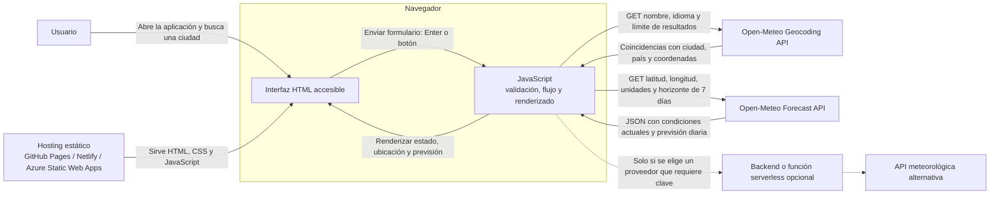

# Análisis de proyecto: Tiempo en mi ciudad

Documento de análisis para definir un MVP de previsión meteorológica web, estático y sencillo, antes de implementar la aplicación.

## 1. Objetivo

Crear una página adaptable a móvil y escritorio en la que una persona escriba el nombre de una ciudad, pulse **Enter** o **Buscar** y consulte el tiempo actual y la previsión de los próximos siete días.

La propuesta usa HTML semántico, JavaScript nativo y las API públicas de Open-Meteo. No necesita servidor, base de datos, cuenta de usuario ni una clave API para el uso gratuito no comercial descrito por el proveedor.

## 2. Usuario y recorrido principal

**Historia de usuario:** Como persona que quiere consultar el tiempo, quiero buscar una ciudad y ver de forma clara las condiciones actuales y la previsión semanal.

1. La página presenta un campo etiquetado, un botón de búsqueda y una indicación de formato, por ejemplo, `Madrid` o `Madrid, España`.
2. La búsqueda se inicia al enviar el formulario, tanto con Enter como con el botón.
3. La aplicación busca coincidencias geográficas. Si hay más de una ubicación plausible, permite elegir mostrando ciudad, región y país; no selecciona silenciosamente una ciudad ambigua.
4. Con las coordenadas de la ubicación elegida, solicita la previsión y muestra el estado actual y una tarjeta por día.
5. Durante la operación muestra carga; si no hay coincidencias o falla un servicio, ofrece un mensaje comprensible y la posibilidad de volver a intentarlo.

## 3. Alcance del MVP

### Incluido

- Búsqueda por nombre de ciudad, con opción de añadir país o región para desambiguar.
- Inicio de búsqueda por Enter o botón.
- Selector de coincidencias cuando haga falta.
- Condiciones actuales: temperatura, sensación térmica, humedad, viento y código/ descripción del tiempo.
- Previsión diaria de siete días: icono o símbolo, descripción, máximas y mínimas y probabilidad máxima de precipitación cuando esté disponible.
- Celsius por defecto, con un conmutador Celsius/Fahrenheit que actualiza todas las temperaturas de la vista; fechas presentadas en español.
- Una tarjeta visual de previsión inspirada en la referencia compartida, sin valores de ejemplo fijos ni datos meteorológicos inventados.
- Estados de carga, resultados, búsqueda sin coincidencias y errores de red/API.
- Interfaz responsive y operable con teclado.
- Atribución visible a la fuente de datos.
- Versión de la aplicación visible en el pie de página.

### Fuera del MVP

- Cuentas, favoritos persistentes, base de datos o historial.
- Mapa, búsqueda automática por GPS, alertas o notificaciones.
- Previsión horaria y comparación entre modelos meteorológicos.
- Backend propio, salvo que la elección futura de proveedor o sus condiciones lo hagan necesario.

## 4. Servicios y contrato de integración

### Proveedor recomendado: Open-Meteo

La geocodificación y la previsión son dos endpoints separados. La aplicación consulta primero la ciudad y después usa la latitud y longitud devueltas para consultar el tiempo.

**Geocoding API**

```text
GET https://geocoding-api.open-meteo.com/v1/search
    ?name={ciudad}
    &count=5
    &language=es
    &format=json
```

- Codificar los parámetros con `URLSearchParams`; no concatenar directamente el texto introducido en la URL.
- Mostrar, cuando existan, nombre, región y país de cada coincidencia.
- La API documenta coincidencias exactas para búsquedas de dos caracteres y coincidencias por prefijo para búsquedas de tres o más; una búsqueda vacía o de un carácter no devuelve resultados. Conviene exigir al menos dos caracteres y ofrecer ejemplos de búsqueda.

**Forecast API**

```text
GET https://api.open-meteo.com/v1/forecast
    ?latitude={latitud}
    &longitude={longitud}
    &current=temperature_2m,relative_humidity_2m,apparent_temperature,is_day,precipitation,weather_code,wind_speed_10m
    &daily=weather_code,temperature_2m_max,temperature_2m_min,precipitation_probability_max
    &temperature_unit=celsius
    &wind_speed_unit=kmh
    &precipitation_unit=mm
    &timezone=auto
    &forecast_days=7
```

- Presentar las unidades que devuelve la API (`current_units` y `daily_units`) junto con los valores.
- Formatear fechas con `Intl.DateTimeFormat` y el locale `es-ES`.
- Traducir los códigos `weather_code` según la tabla WMO enlazada en la documentación del proveedor; mantener esa correspondencia en un único lugar del código.
- Conservar los valores recibidos en Celsius y convertirlos solo al presentarlos en Fahrenheit (`°F = °C × 9/5 + 32`). Aplicar la conversión de forma coherente a temperatura actual, sensación térmica y máximas/mínimas; el cambio de unidad no debe generar otra llamada a la API.
- Comprobar respuestas HTTP y estructura de datos antes de renderizar. No presentar datos de una búsqueda anterior como si pertenecieran a la nueva.

### Límites y atribución

Según la página de precios de Open-Meteo consultada para este análisis, la API gratuita es para uso no comercial, está limitada a 10.000 llamadas por día y no ofrece garantía de disponibilidad. Sus datos requieren atribución bajo CC BY 4.0. El MVP debe mostrar un crédito visible, por ejemplo: **«Datos meteorológicos: Open-Meteo»**, enlazado al proveedor. Antes de publicar, confirmar que el uso y la licencia vigentes cubren el caso concreto.

Si la aplicación se destina a un uso comercial o necesita una garantía de disponibilidad, revisar el plan comercial de Open-Meteo u otro proveedor. No poner claves de servicios de pago en JavaScript público; utilizar una función/backend como intermediario y guardar allí los secretos.

## 5. Diagrama de arquitectura



El hosting entrega los archivos estáticos. En el MVP, el navegador llama directamente a las API de geocodificación y previsión por HTTPS; no hay un servidor de aplicación. La ruta punteada es una opción futura para proveedores que exijan una clave secreta, lógica de caché o control centralizado de cuotas.

## 6. Servicios conectables

| Necesidad | Servicio recomendado | Alternativas o evolución |
|---|---|---|
| Convertir el nombre de ciudad en coordenadas | Open-Meteo Geocoding API | Un servicio de geocodificación independiente si se cambia de proveedor |
| Consultar tiempo actual y previsión | Open-Meteo Forecast API | OpenWeather o WeatherAPI, previa revisión de sus planes, límites, licencia y requisitos de clave |
| Publicar la web estática | GitHub Pages, Netlify o Azure Static Web Apps | Cualquier hosting que sirva HTML, CSS y JavaScript estáticos por HTTPS |
| Proteger una clave o añadir caché propia | No necesario para el MVP | Backend pequeño o función serverless, como Azure Functions, Netlify Functions o Cloudflare Workers |

Las alternativas son puntos de integración posibles, no dependencias del MVP. Si se adopta un proveedor que requiere credenciales, la clave debe permanecer en el servidor y nunca incluirse en el HTML, el repositorio o el bundle del navegador.

## 7. Diseño técnico y visual

- Mantener la solución como sitio estático con módulos JavaScript del navegador; no introducir un framework o una base de datos para este alcance.
- Estructura inicial sugerida:

  ```text
  index.html
  styles.css
  src/
    app.js
    weather-api.js
    weather-codes.js
    weather-utils.js
  ```

- `index.html`: formulario semántico y regiones de estado/resultados.
- `app.js`: envío del formulario, selección de ubicación, estados de carga/error y coordinación del renderizado.
- `weather-api.js`: construcción de peticiones y validación de respuestas de Open-Meteo.
- `weather-codes.js`: traducción de códigos WMO a descripciones e iconos.
- `weather-utils.js`: conversión Celsius/Fahrenheit y formato de fechas, en funciones comprobables sin llamadas de red.
- `styles.css`: layout responsive, estados visibles y jerarquía tipográfica.
- Tailwind no es necesario para el MVP. Para reducir dependencias y mantener el sitio estático, se recomienda CSS local; si el equipo prefiere Tailwind, usarlo compilado en el proceso de build, no depender de su CDN para una publicación de producción.

### Referencia visual de la previsión

La captura visual compartida durante el desarrollo no se distribuye en este repositorio público. La siguiente descripción conserva las decisiones de composición y ambiente que guiaron la implementación.

Tomar esta descripción como referencia de composición y ambiente, sin copiar marcas ni depender de recursos gráficos de terceros:

- Mantener el formulario de búsqueda en la página, por encima de la tarjeta; la referencia define el aspecto de la previsión, no reemplaza la búsqueda solicitada.
- Usar una página clara y despejada y una tarjeta principal amplia, con esquinas muy redondeadas, sombra discreta y un fondo atmosférico en tonos de cielo azul pálido y horizonte cálido.
- En la parte superior de la tarjeta, mostrar ciudad y país, hora/etiqueta «Ahora» y descripción del estado del cielo. La temperatura actual debe ser el elemento más destacado; colocar cerca el conmutador `°C`/`°F` y las máximas y mínimas del día.
- Añadir, si se muestra un resumen textual encima de la tarjeta, generarlo con los datos reales de esa búsqueda. No fijar en el diseño temperaturas, ciudad o condiciones de ejemplo.
- Incluir en la zona inferior una banda clara y suavemente translúcida con siete columnas para los días, un icono meteorológico y las temperaturas máxima y mínima. En pantallas estrechas, conservar las siete jornadas en una banda horizontal desplazable y accesible, en vez de comprimirlas hasta volver ilegibles sus etiquetas.
- Usar gradientes CSS e iconos propios sencillos (CSS o SVG en línea) para el sol, nubes y precipitación; la imagen de referencia no debe convertirse en una dependencia de red. Un fondo decorativo puede variar según día/noche o condición, pero el texto siempre debe conservar contraste suficiente.
- Mantener el crédito «Datos meteorológicos: Open-Meteo» como enlace visible, por ejemplo en una pequeña etiqueta discreta; no reutilizar la etiqueta de marca que aparece en la referencia.
- En carga, error y ausencia de resultados, mantener una presentación coherente con la tarjeta sin mostrar datos anteriores como si fueran actuales.

## 8. Requisitos de calidad

### Accesibilidad y experiencia

- Usar un `<form>` real, `<label>` asociado al campo y botón con nombre accesible; así Enter funciona de manera nativa.
- Anunciar cambios de estado con una región `aria-live="polite"` y conservar el foco en el flujo de búsqueda.
- Permitir el uso completo con teclado y mostrar foco visible.
- Mostrar claramente la unidad, la ubicación seleccionada y el país para evitar confusiones entre ciudades homónimas.
- Hacer que el conmutador `°C`/`°F` sea accesible por teclado y anuncie su estado; cambiar la unidad de todas las temperaturas a la vez.
- Dar feedback inmediato durante la carga; impedir envíos duplicados mientras una petición esté activa y permitir reintentar tras un error.

### Robustez, seguridad y privacidad

- Consultar solo endpoints HTTPS y solicitar datos al enviar el formulario, no en cada pulsación.
- Tratar por separado entrada vacía, ausencia de resultados, ubicación ambigua, error HTTP, JSON inválido, timeout y falta de conexión.
- Usar `AbortController` para cancelar peticiones que ya no correspondan a la búsqueda activa o que excedan un timeout razonable.
- Insertar nombres devueltos por el servicio como texto (`textContent`), no como HTML sin escapar.
- No almacenar datos personales ni búsquedas en un servidor. Informar de que el nombre de ciudad y las coordenadas se envían al proveedor meteorológico.
- No añadir claves secretas al frontend. Revisar atribución, licencia, límites y política de uso antes de publicar.

## 9. Criterios de aceptación

1. Es posible buscar una ciudad con Enter y con el botón.
2. No se envía una búsqueda vacía ni de menos de dos caracteres; se explica cómo introducir la ciudad.
3. Una búsqueda válida muestra la ubicación correcta; si hay varias coincidencias, el usuario puede elegir entre ellas.
4. Tras elegir ubicación, se muestran condiciones actuales y hasta siete días de previsión con fechas, descripciones y unidades dentro de una tarjeta siguiendo la referencia visual descrita.
5. El usuario puede alternar entre Celsius y Fahrenheit; todas las temperaturas se actualizan de forma coherente sin volver a consultar las API.
6. Una ciudad sin resultados, una API caída o una respuesta no válida producen un mensaje útil, sin dejar un indicador de carga permanente ni mostrar previsión obsoleta como nueva.
7. La interfaz funciona en móvil y escritorio; la banda de siete días sigue siendo legible y accesible con teclado.
8. La fuente y atribución requeridas son visibles, y la aplicación no expone claves secretas.
9. El pie de página muestra la versión actual de la aplicación.

## 10. Verificación propuesta

- Comprobar manualmente una ciudad conocida, una búsqueda ambigua, una ciudad inexistente, una búsqueda de dos caracteres y una interrupción de red.
- Verificar en el navegador que se realizan las dos peticiones esperadas y que la respuesta de previsión corresponde a las coordenadas elegidas.
- Probar Enter, botón, foco visible, mensajes anunciados, estados de carga/error y tamaños de pantalla móvil/escritorio.
- Las pruebas automatizadas cubren la conversión de temperaturas, el formateo de fechas, los códigos WMO y el contrato de las API con respuestas simuladas; no dependen de llamadas a servicios reales.


## 11. Referencias oficiales

- [Documentación de Open-Meteo Forecast API](https://open-meteo.com/en/docs)
- [Documentación de Open-Meteo Geocoding API](https://open-meteo.com/en/docs/geocoding-api)
- [Planes, límites y licencia de Open-Meteo](https://open-meteo.com/en/pricing)
- [Licencia CC BY 4.0](https://creativecommons.org/licenses/by/4.0/)
