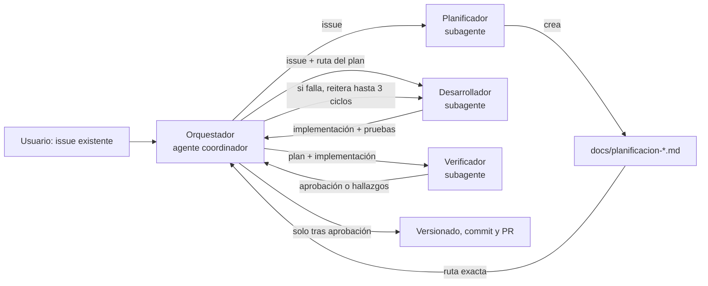
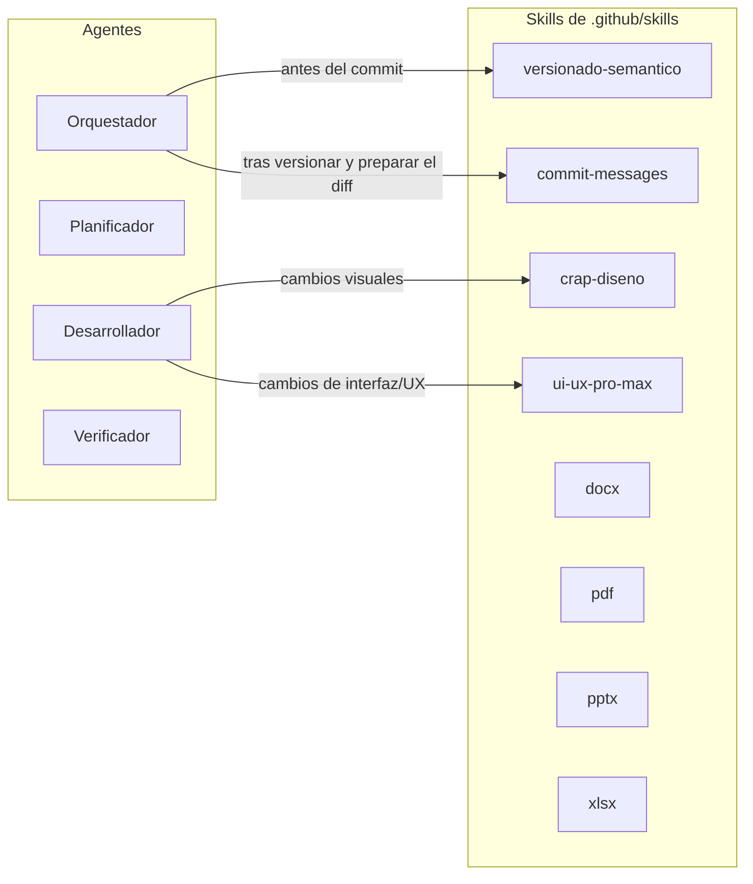
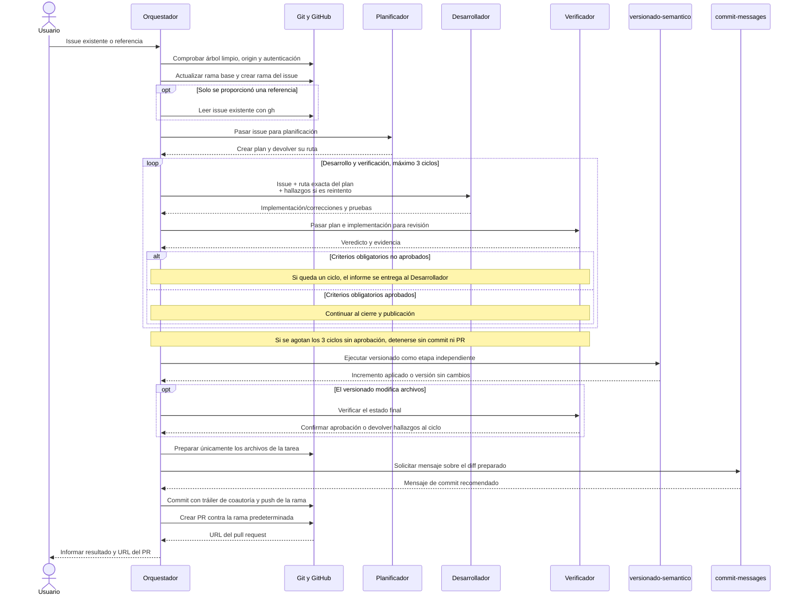
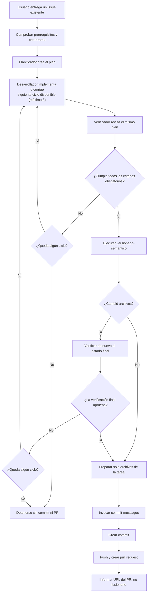

# Arquitectura de agentes y skills

Este documento describe los cuatro agentes del proyecto: un Orquestador coordinador y tres subagentes —Planificador, Desarrollador y Verificador—. El flujo parte de un issue existente, crea una rama y termina con un pull request aprobado; no crea issues ni fusiona el PR.

## Mapa de un vistazo

El usuario habla con el Orquestador. Este reparte el trabajo y conserva la ruta del plan entre el Planificador, el Desarrollador y el Verificador. El Desarrollador implementa el plan y atiende las correcciones solicitadas por el Verificador; no hay un agente Implementador separado.

## Inventario de agentes

| Agente | Archivo | Responsabilidad |
|---|---|---|
| **Orquestador de issues** | [orquestador-issues.agent.md](../.github/agents/orquestador-issues.agent.md) | Recibe un issue existente, crea una rama antes de delegar, coordina a los tres subagentes y prepara la publicación cuando el Verificador aprueba. No crea issues ni implementa funcionalidad directamente. |
| **Planificador de issues** | [planificador-issues.agent.md](../.github/agents/planificador-issues.agent.md) | Analiza el issue y crea un plan accionable en `docs/`. Devuelve la ruta exacta del documento; no implementa. |
| **Desarrollador de planes** | [desarrollador-planes.agent.md](../.github/agents/desarrollador-planes.agent.md) | Implementa el plan en el primer ciclo y corrige hallazgos verificados en ciclos posteriores. Ejecuta pruebas; no crea commits, ramas ni PR. |
| **Verificador de planes** | [verificador-planes.agent.md](../.github/agents/verificador-planes.agent.md) | Compara la implementación con los criterios del plan, ejecuta comprobaciones pertinentes y emite un veredicto independiente. No modifica archivos. |

El Desarrollador y el Verificador repiten el ciclo hasta que se aprueben los criterios obligatorios o se completen **tres ciclos**. Si se agota el límite, el Orquestador se detiene sin publicar.

## Skills del proyecto

El inventario incluye todas las skills presentes en `.github/skills/`. Las skills sin agente llamador siguen disponibles para invocación directa cuando corresponda.

| Skill | Uso en el flujo |
|---|---|
| [versionado-semantico](../.github/skills/versionado-semantico/SKILL.md) | **Orquestador**: tras la verificación aprobada y antes de preparar el commit. Determina el incremento de versión o confirma que no corresponde. |
| [commit-messages](../.github/skills/commit-messages/SKILL.md) | **Orquestador**: después del versionado y de preparar el diff, redacta el mensaje del commit. |
| [crap-diseno](../.github/skills/crap-diseno/SKILL.md) | **Desarrollador**, si el plan o las correcciones afectan al diseño visual. |
| [ui-ux-pro-max](../.github/skills/ui-ux-pro-max/SKILL.md) | **Desarrollador**, si el plan o las correcciones afectan a la interfaz o experiencia de usuario. |
| [docx](../.github/skills/docx/SKILL.md) | Sin agente llamador. |
| [pdf](../.github/skills/pdf/SKILL.md) | Sin agente llamador. |
| [pptx](../.github/skills/pptx/SKILL.md) | Sin agente llamador. |
| [xlsx](../.github/skills/xlsx/SKILL.md) | Sin agente llamador. |

Por tanto, las skills sin agente llamador son **docx**, **pdf**, **pptx** y **xlsx**.

## Ciclo completo, paso a paso

El siguiente diagrama representa el proceso habitual desde que el usuario entrega el issue hasta que el pull request está creado. El PR no se fusiona automáticamente.

## Flujo de control

Este diagrama deja explícitas las condiciones de parada y el límite de reintentos, incluido el caso en que el versionado semántico modifica archivos.

Si falla un prerrequisito, un agente se bloquea, se agotan los tres ciclos o no se aprueba una verificación final, el Orquestador informa del motivo y no publica el trabajo.
